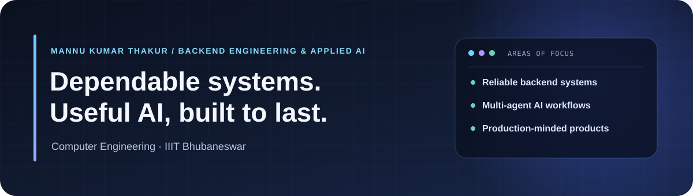

  

  <a href="https://www.linkedin.com/in/mannu-kumar-thakur-6903a0348">LinkedIn</a>
  &nbsp;·&nbsp;
  <a href="https://github.com/Mannu-Thakur?tab=repositories">Projects</a>

## About

I’m **Mannu Kumar Thakur**, a Computer Engineering student at **IIIT Bhubaneswar** focused on backend engineering and applied AI. I build reliable services and intelligent workflows, with an emphasis on clear architecture, maintainability, and practical impact.

<table>
  <tr>
    <td align="center" width="33%"><strong>800+</strong> DSA problems solved</td>
    <td align="center" width="33%"><strong>Backend Engineering</strong> APIs · system design · distributed systems</td>
    <td align="center" width="33%"><strong>Agentic AI</strong> LangGraph · RAG · LLM orchestration</td>
  </tr>
</table>

## Technology

  

## Selected Work

<table>
  <tr>
    <td valign="top" width="33%">
      <h3><a href="https://github.com/Mannu-Thakur/Agentic_AI_assistant">Agentic AI Assistant</a></h3>
      
An agentic AI workspace built around a LangGraph supervisor and seven specialists for coding, research, retrieval, vision, document, and data-analysis workflows. Mission Mode surfaces execution progress, artifacts, and human review.

      
Python · FastAPI · LangGraph · React · TypeScript · Hybrid RAG

    </td>
    <td valign="top" width="33%">
      <h3><a href="https://github.com/Mannu-Thakur/bugX">bugX</a></h3>
      
A competitive coding platform with structured practice, real-time battles, guided problem solving, and algorithm visualizations.

      
React · TypeScript · FastAPI · PostgreSQL · WebSockets

    </td>
    <td valign="top" width="33%">
      <h3><a href="https://github.com/Mannu-Thakur/Shopverse">Shopverse (ChaseMart)</a></h3>
      
A full-stack commerce platform with customer shopping flows, an admin dashboard, inventory and order management, and online payments.

      
React · Node.js · Express · MongoDB · Stripe · Razorpay

    </td>
  </tr>
</table>

## Current Focus

Multi-agent orchestration · scalable backend design · cloud-native deployment

---

  <strong>Design carefully. Build reliably. Keep learning.</strong>

